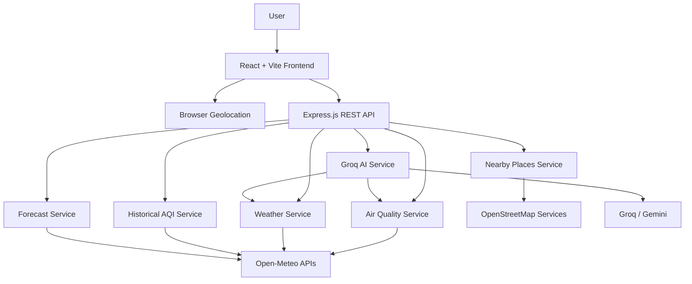

# 🌿 SaansSaathi
### Breathe Smarter. Live Safer.

<p align="center">
  **An AI-powered Environmental Intelligence Platform**
  <br/>
  Transforming real-world air-quality data into intelligent, location-aware environmental insights.
</p>

<p align="center">
  
  
  
  
  
  
</p>

---

## 01. Overview

**SaansSaathi** is a location-aware environmental intelligence platform designed to help people understand air pollution and make informed everyday decisions.

Traditional air-quality applications primarily display numerical pollution readings. SaansSaathi takes a more intelligent approach by combining environmental data, weather context, historical insights and Generative AI.

The platform translates environmental measurements into understandable information, conversational explanations and practical recommendations.

### Core capabilities

- Real-time, location-based air-quality monitoring.
- Hourly AQI forecasting and historical analysis.
- AI-powered environmental conversations.
- Weather-aware environmental intelligence.
- Personalized lifestyle and health-awareness recommendations.
- Nearby hospital and clinic discovery.

---

## 02. Product Features

| Module | Capabilities |
|---|---|
| Air Quality Intelligence | US AQI, European AQI, PM2.5, PM10 and pollutant information |
| AQI Forecasting | Upcoming hourly air-quality predictions |
| Historical Analysis | Date-specific hourly AQI and pollutant readings |
| AI Assistant | Context-aware environmental conversations using Groq |
| Weather Intelligence | Temperature, humidity, wind and other weather conditions |
| Location Intelligence | Browser geolocation and reverse geocoding |
| Health Advisory | General air-quality awareness and exposure guidance |
| Nearby Healthcare | Hospital and clinic discovery using OpenStreetMap |
| Lifestyle Personalization | Recommendations informed by user lifestyle preferences |

### AI Environmental Assistant

The conversational assistant is designed to do more than generate generic chatbot responses.

It can use available environmental context to answer questions about:

- Current air quality.
- Historical AQI at a particular date and time.
- Weather conditions.
- Environmental exposure awareness.
- Nearby hospitals and clinics.

Groq provides the primary conversational intelligence, while backend services retrieve relevant external data for context-dependent responses.

---

## 03. Technology Stack

### Frontend

| Technology | Purpose |
|---|---|
| React 19 | Component-based user interface |
| Vite | Development server and production build |
| JavaScript (ES Modules) | Application logic |
| CSS | Responsive interface styling |
| Recharts | Environmental data visualization |
| Lucide React | Interface icons |
| Fetch API | Backend communication |

### Backend

| Technology | Purpose |
|---|---|
| Node.js | JavaScript runtime |
| Express.js 5 | REST API framework |
| Groq SDK | Generative AI integration |
| Google GenAI SDK | Gemini integration |
| Axios / Fetch | External API communication |
| Zod | Data validation |
| Helmet | HTTP security headers |
| CORS | Cross-origin request configuration |
| Express Rate Limit | Request rate limiting |
| dotenv | Environment configuration |

### External Data & Intelligence

| Service | Integration |
|---|---|
| Open-Meteo Air Quality API | Current and historical air-quality data |
| Open-Meteo Weather API | Weather and atmospheric conditions |
| Groq API | Conversational AI intelligence |
| Google Gemini | Additional AI integration |
| OpenStreetMap Nominatim | Reverse geocoding |
| OpenStreetMap Overpass API | Nearby hospitals and clinics |

---

## 04. System Architecture



### Request lifecycle

1. The frontend obtains the user's location through browser geolocation.
2. Coordinates are used to retrieve relevant environmental information.
3. The Express backend communicates with external data providers.
4. Environmental services normalize and validate the returned information.
5. Relevant context is passed to the AI service when a conversational request requires it.
6. The frontend presents the resulting information through dashboards, charts and conversational responses.

---

## 05. Project Structure

```text
SaansSaathi/
│
├── client/
│   ├── public/
│   ├── src/
│   │   ├── components/
│   │   ├── services/
│   │   ├── App.jsx
│   │   └── ...
│   ├── package.json
│   └── vite.config.js
│
├── server/
│   ├── src/
│   │   ├── config/
│   │   ├── controllers/
│   │   ├── middleware/
│   │   ├── routes/
│   │   ├── services/
│   │   ├── utils/
│   │   └── server.js
│   ├── .env.example
│   └── package.json
│
├── .gitignore
└── README.md
```

The application follows a modular frontend/backend architecture, separating UI components, API routes, controllers and external service integrations.

---

## 06. Installation & Setup

### Prerequisites

- Node.js (LTS recommended)
- npm
- Git
- Groq API key
- Google Gemini API key (if using the Gemini integration)

### Clone the repository

```bash
git clone https://github.com/RockyRohith12/SaansSaathi.git

cd SaansSaathi
```

### Configure the backend

```bash
cd server
npm install
```

Create a `.env` file inside `server/`:

```env
GROQ_API_KEY=your_groq_api_key
GEMINI_API_KEY=your_gemini_api_key
PORT=5000
```

Use `.env.example` as your configuration reference.

### Start the backend

```bash
npm run dev
```

Backend development URL:

```text
http://localhost:5000
```

Health check:

```text
http://localhost:5000/api/health
```

### Configure the frontend

Open another terminal:

```bash
cd client
npm install
```

### Start the frontend

```bash
npm run dev
```

Frontend development URL:

```text
http://localhost:5173
```

---

## 07. API Reference

The backend exposes the following REST API modules:

| Endpoint | Method | Description |
|---|---|---|
| `/api/health` | GET | Backend health check |
| `/api/air-quality` | GET | Current air-quality information |
| `/api/forecast` | GET | Hourly AQI forecast |
| `/api/historical-air-quality` | GET | Historical air-quality readings |
| `/api/weather` | GET | Weather information |
| `/api/nearby-places` | GET | Nearby healthcare facilities |
| `/api/ai` | POST | AI assistant conversation |

*Query parameters and request payloads depend on the individual endpoint. Refer to the corresponding route and controller implementations.*

---

## 08. Environmental Data & Reliability

SaansSaathi integrates external environmental data rather than relying exclusively on static or hardcoded values.

### Data interpretation

- Air-quality and forecast information is obtained through Open-Meteo.
- Weather information is retrieved through Open-Meteo.
- Location details are obtained using OpenStreetMap geocoding.
- Nearby healthcare facilities are discovered through OpenStreetMap data.

**Important:** Open-Meteo air-quality values are model-based estimates. They should not be represented as direct measurements from government ground-monitoring stations.

Health-related recommendations are general awareness information and are not medical diagnoses or a replacement for professional medical advice.

---

## 09. Security & Engineering Practices

- Environment-based API key management.
- `.env` files excluded from version control.
- Centralized backend service and controller organization.
- Input validation for location-dependent requests.
- HTTP security headers through Helmet.
- Configurable CORS.
- Request rate-limiting middleware.
- Error handling for external API failures.

---

## 10. Roadmap

| Enhancement | Status |
|---|---|
| Location-aware AQI monitoring | Implemented |
| Weather integration | Implemented |
| Hourly AQI forecast | Implemented |
| Historical AQI retrieval | Implemented |
| Groq-powered AI assistant | Implemented |
| Nearby hospital discovery | Implemented |
| Production deployment | Planned |
| Community pollution reporting | Planned |
| Indoor air-quality intelligence | Planned |
| Long-term environmental analytics | Planned |
| Persistent user profiles and conversation history | Planned |

---

## 11. Vision

SaansSaathi aims to bridge the gap between environmental data and everyday decision-making.

By combining real-world environmental information with Generative AI, the platform seeks to make air-quality intelligence more accessible, understandable and actionable.

**The goal is not simply to tell people what the air quality is, but to help them understand what it means for their day.**

---

## 12. Author

**Rohith**

GitHub: [@RockyRohith12](https://github.com/RockyRohith12)

Project Repository: [SaansSaathi](https://github.com/RockyRohith12/SaansSaathi)

---

<p align="center">
  <b>SaansSaathi</b>
  <br/>
  Breathe Smarter. Live Safer. 🌿
</p>
