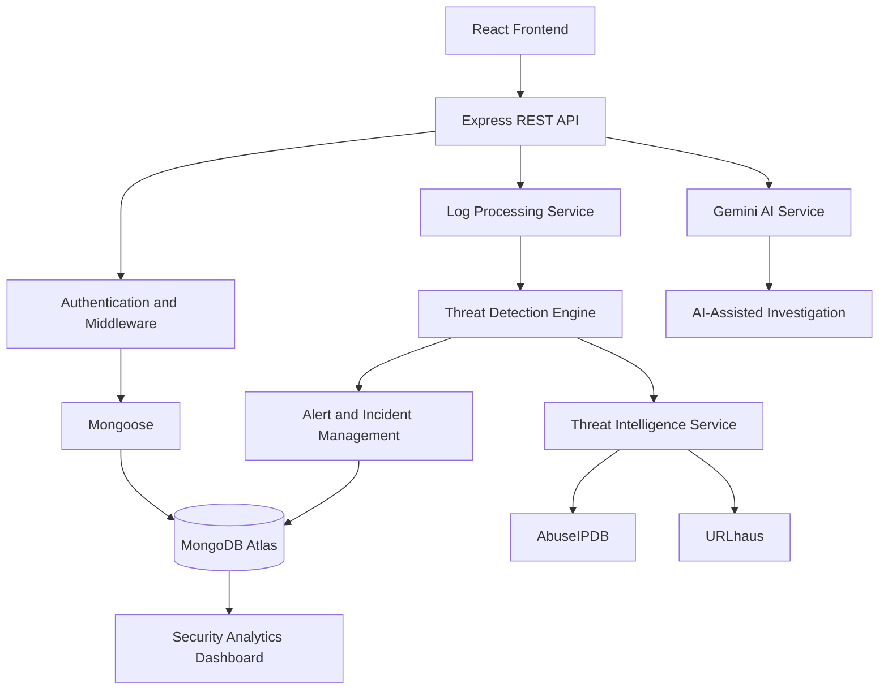

# ThreatLens 🛡️

### AI-Assisted Cyber Threat Intelligence & Incident Investigation Platform

<p align="center">
  <strong>Turning security logs into actionable threat intelligence.</strong>
</p>

<p align="center">
  A full-stack cybersecurity platform for analyzing security logs, detecting suspicious activity, enriching threat indicators, and managing security incidents through a unified dashboard.
</p>

<p align="center">
  
</p>

<p align="center">
  
  
  
  
  
  
</p>

---

## 📌 Overview

ThreatLens is a cybersecurity threat intelligence and incident investigation platform designed to help security analysts identify suspicious activity in security logs and investigate potential threats.

The platform aims to combine log ingestion, rule-based threat detection, threat intelligence enrichment, incident management, security analytics, and AI-assisted investigation in one interface.

Instead of manually examining large volumes of log data, users will be able to upload supported log files, identify potentially malicious patterns, investigate suspicious indicators, and track security incidents through their lifecycle.

**Project Vision:** Build an extensible, practical security investigation platform that transforms raw security events into structured findings that analysts can investigate.

### Current Development Status

The initial full-stack foundation has been implemented.

**Completed**
- [x] React + TypeScript + Vite frontend setup
- [x] Tailwind CSS integration
- [x] Node.js + Express backend setup
- [x] Frontend-to-backend API communication
- [x] MongoDB Atlas cloud database connection
- [x] Mongoose database integration
- [x] Initial User schema and model
- [x] User registration API
- [x] Password hashing using bcryptjs
- [x] Backend health-check endpoint

**In Progress / Planned**
- [ ] Duplicate registration testing
- [ ] User login API
- [ ] JWT authentication
- [ ] Protected routes
- [ ] Security log ingestion
- [ ] Rule-based threat detection
- [ ] Threat intelligence integrations
- [ ] Gemini AI investigation
- [ ] Security analytics dashboard

---

## 🎯 Problem Statement

Security logs can contain large volumes of events, making it difficult to identify suspicious behavior quickly. Investigating potential threats may also require analysts to switch between log files, threat intelligence sources, and incident tracking tools.

ThreatLens aims to address these challenges by providing:

- Centralized ingestion of supported security logs.
- Automated detection of suspicious patterns using transparent rules.
- Threat intelligence enrichment for supported indicators.
- A unified view of alerts, incidents, and investigation status.
- Security analytics to help users understand event patterns and alert trends.
- AI-assisted explanations grounded in the available investigation evidence.

---

## ✨ Key Features

Features are planned for incremental development. Their implementation and availability will be updated as the project progresses.

### 📂 Security Log Ingestion

- Upload supported CSV and JSON security logs.
- Validate input data and handle malformed records.
- Normalize supported log formats into a consistent event structure.
- Track ingestion results and processing errors.

### 🔍 Rule-Based Threat Detection

- Identify suspicious activity using configurable detection rules.
- Flag events matching defined security conditions.
- Assign severity levels to detected alerts.
- Record the evidence and rule responsible for each alert.

### 🌐 Threat Intelligence Enrichment

- Extract supported indicators such as IP addresses and URLs from security events.
- Integrate with external threat intelligence services such as AbuseIPDB and URLhaus.
- Enrich indicators with available reputation and threat context.
- Handle API errors, rate limits, and unavailable results gracefully.

### 🚨 Alert Management

- View and filter alerts by severity, status, and time.
- Inspect the underlying event and detection evidence.
- Track alerts through an investigation workflow.
- Reduce duplicate findings where appropriate.

### 🕵️ Incident Investigation

- Group related alerts into incidents.
- Maintain investigation notes and status.
- Track incident severity and resolution.
- Preserve a clear trail of investigation decisions.

### 📊 Security Analytics Dashboard

- Display event, alert, and incident summaries.
- Visualize alert severity distribution.
- Explore trends in security events over time.
- Highlight important findings for further investigation.

### 🤖 AI-Assisted Investigation

- Use the Google Gemini API to summarize investigation evidence.
- Explain why an alert may require attention.
- Suggest practical next steps for analyst review.
- Keep AI analysis grounded in supplied event and threat-intelligence data.

AI-generated output is intended to assist analysts, not replace human investigation or confirm malicious activity on its own.

### 🔐 Authentication and Security

**Implemented foundation:**
- Initial user schema using Mongoose.
- User registration endpoint.
- Password hashing using bcryptjs.
- Duplicate-email handling in registration.
- Environment-based configuration for database credentials.

**Planned:**
- JWT-based authentication.
- Protected API routes.
- Role-based access control.
- Improved request validation and security testing.

---

## 🖥️ Application Preview

The following image paths are placeholders. Add your own screenshots to the `images/` directory as the corresponding features become available.

### Dashboard

<p align="center">
  
</p>

Planned view: security event summaries, alert statistics, severity distribution, and recent activity.

### Alert Investigation

<p align="center">
  
</p>

Planned view: searchable alerts with severity, detection reasons, and investigation status.

### Incident Management

<p align="center">
  
</p>

Planned view: incident details, related alerts, investigation notes, and resolution tracking.

---

## 🏗️ System Architecture

ThreatLens is being developed as a MERN-based full-stack application, with a React frontend, Node.js/Express API, MongoDB persistence, and external AI and threat intelligence integrations.

### Architecture Components

| Component | Responsibility |
|---|---|
| React + TypeScript | User interface and dashboard |
| Tailwind CSS | Frontend styling and responsive layouts |
| Node.js + Express | Backend API and request handling |
| Mongoose | MongoDB object modeling |
| Log Processing Service | Validation and normalization of uploaded logs |
| Detection Engine | Evaluation of security events against detection rules |
| Threat Intelligence Service | Enrichment of supported indicators |
| Google Gemini API | Evidence-grounded AI-assisted investigation |
| MongoDB Atlas | Persistent cloud database |
| Analytics Layer | Aggregation of data for dashboard visualizations |

The architecture represents the intended design. Components will be implemented incrementally.

### Application Flow



---

## 🧰 Technology Stack

| Technology | Purpose |
|---|---|
| React | Frontend user interface |
| TypeScript | Type-safe frontend development |
| Vite | Frontend development and build tooling |
| Tailwind CSS v4 | Styling and responsive UI |
| Node.js | Backend JavaScript runtime |
| Express.js | REST API framework |
| MongoDB Atlas | Cloud NoSQL database |
| Mongoose | MongoDB object modeling |
| bcryptjs | Password hashing |
| dotenv | Environment variable management |
| Helmet | HTTP security headers |
| CORS | Cross-origin resource sharing |
| express-rate-limit | API rate limiting |
| Google Gemini API | Planned AI-assisted investigation |
| AbuseIPDB | Planned IP address reputation enrichment |
| URLhaus | Planned malicious URL intelligence |
| JWT | Planned authentication |
| Jest + Supertest | Planned backend testing |
| Git & GitHub | Version control and project collaboration |

Additional libraries and integrations will be documented when selected and integrated.

---

## 📁 Project Structure

```text
ThreatLens/
│
├── README.md
│
├── frontend/
│   ├── public/
│   ├── src/
│   │   ├── assets/
│   │   ├── components/
│   │   ├── layouts/
│   │   ├── pages/
│   │   ├── services/
│   │   ├── hooks/
│   │   └── types/
│   ├── package.json
│   └── package-lock.json
│
└── server/
    ├── src/
    │   ├── config/
    │   │   └── db.js
    │   │
    │   ├── controllers/
    │   │   └── authController.js
    │   │
    │   ├── middleware/
    │   │
    │   ├── models/
    │   │   └── User.js
    │   │
    │   ├── routes/
    │   │   └── authRoutes.js
    │   │
    │   ├── services/
    │   │   ├── detection/
    │   │   ├── intelligence/
    │   │   └── ai/
    │   │
    │   ├── utils/
    │   │
    │   └── server.js
    │
    ├── tests/
    ├── .env
    ├── .env.example
    ├── package.json
    └── package-lock.json
```

**Note:** `.env` is a local configuration file and must never be committed to GitHub. `.env.example` contains placeholder values only.

This is the current and intended project structure. Additional modules and directories will be added as development continues.

---

## ⚙️ Getting Started

Follow these instructions to run ThreatLens locally.

### Prerequisites

Install the following tools:

- [Node.js](https://nodejs.org/) and npm
- [Git](https://git-scm.com/)
- [Visual Studio Code](https://code.visualstudio.com/)
- A [MongoDB Atlas](https://www.mongodb.com/cloud/atlas) account

### 1. Clone the Repository

```bash
git clone <YOUR_REPOSITORY_URL>

cd ThreatLens
```

Replace `<YOUR_REPOSITORY_URL>` with your actual GitHub repository URL.

### 2. Set Up the Frontend

Open a terminal in the project root:

```bash
cd frontend
```

Install dependencies:

```bash
npm install
```

Start the frontend development server:

```bash
npm run dev
```

Frontend development server:

```text
http://localhost:5173
```

### 3. Set Up the Backend

Open a second terminal in the project root:

```bash
cd server
```

Install dependencies:

```bash
npm install
```

Create a `.env` file inside the `server/` directory using `.env.example` as a reference.

Configure the following variables:

```env
PORT=5000
MONGODB_URI=your_mongodb_connection_string
```

Additional API credentials will be added when their respective integrations are implemented.

**Important:** Never upload your actual `.env` file or database credentials to GitHub.

### 4. Start the Backend

From the `server/` directory:

```bash
npm run dev
```

Backend server:

```text
http://localhost:5000
```

### 5. Verify the Backend

Open:

```text
http://localhost:5000/api/health
```

A successful response from the currently implemented health-check endpoint looks like:

```json
{
  "success": true,
  "message": "ThreatLens API is running!",
  "timestamp": "..."
}
```

### 6. Verify the Database Connection

The backend connects to MongoDB Atlas before starting the Express server.

A successful connection displays messages similar to:

```text
MongoDB connected: <cluster-host>
ThreatLens server running on port 5000
```

If the database connection fails, verify your MongoDB URI, database user credentials, and Atlas network access configuration.

---

## 🔐 Implemented API Endpoints

The following endpoints are currently implemented.

| Method | Endpoint | Description |
|---|---|---|
| GET | `/api/health` | Check backend health |
| POST | `/api/auth/register` | Register a new user |

### User Registration

Endpoint:

```text
POST /api/auth/register
```

Example request:

```json
{
  "name": "Test User",
  "email": "testuser@example.com",
  "password": "TestPass123!"
}
```

The registration controller currently:

- Validates required fields.
- Checks minimum password length.
- Checks for an existing email address.
- Hashes the password using bcryptjs.
- Creates a user record in MongoDB.
- Returns the created user's basic information without exposing the password.

---

## 🗺️ Development Roadmap

### Phase 1 — Initial Application Setup

- [x] Initialize React + TypeScript frontend.
- [x] Configure Tailwind CSS.
- [x] Initialize Node.js + Express backend.
- [x] Add initial backend security middleware.
- [x] Create an API health-check endpoint.
- [x] Establish frontend-to-backend communication.

### Phase 2 — Database and Backend Foundation

- [x] Configure MongoDB Atlas.
- [x] Establish Mongoose database connection.
- [x] Define initial User model.
- [x] Create initial authentication route and controller.
- [x] Implement user registration API.
- [x] Implement password hashing using bcryptjs.
- [ ] Add additional security event and incident models.
- [ ] Expand request validation and automated tests.

### Phase 3 — Authentication

- [ ] Test duplicate registration.
- [ ] Implement user login.
- [ ] Add JWT authentication.
- [ ] Implement authentication middleware.
- [ ] Protect application routes.
- [ ] Add role-based access control.

### Phase 4 — Log Management

- [ ] Implement CSV/JSON log upload.
- [ ] Validate and normalize log records.
- [ ] Store and retrieve security events.
- [ ] Handle malformed and unsupported input files.

### Phase 5 — Threat Detection

- [ ] Develop configurable rule-based detections.
- [ ] Assign alert severity and risk scores.
- [ ] Store detection evidence.
- [ ] Test detection rules against sample logs.

### Phase 6 — Threat Intelligence

- [ ] Integrate AbuseIPDB.
- [ ] Integrate URLhaus.
- [ ] Handle rate limits and external API failures.
- [ ] Display enrichment results during investigations.

### Phase 7 — Dashboard and Incident Management

- [ ] Build the security analytics dashboard.
- [ ] Implement alert search and filtering.
- [ ] Create incident investigation workflows.
- [ ] Connect frontend pages to backend APIs.

### Phase 8 — AI-Assisted Investigation

- [ ] Integrate the Gemini API through the backend.
- [ ] Generate evidence-grounded alert summaries.
- [ ] Provide investigation suggestions with human review.

### Phase 9 — Testing and Deployment

- [ ] Test major user workflows.
- [ ] Review security controls and input validation.
- [ ] Document deployment and configuration.
- [ ] Deploy the application and publish a live demo if feasible.

---

## 🧪 Testing

Automated testing will cover the core application logic as the project develops, including:

- Log parsing and validation.
- Rule-based detection behavior.
- Alert creation and severity assignment.
- API request validation and error responses.
- Authentication and authorization.
- Database operations and incident workflows.

Test commands and coverage information will be added once the test suite is established.

---

## 🔒 Security Considerations

ThreatLens is intended as a defensive cybersecurity and investigation project.

- Use synthetic, anonymized, or otherwise authorized security logs for development and demonstrations.
- Validate uploaded files and impose appropriate size and format limits.
- Keep credentials out of source control.
- Store passwords using secure password hashing.
- Treat external threat intelligence results as contextual evidence, not definitive proof of malicious activity.
- Do not expose sensitive logs, investigation notes, or API credentials in public deployments.
- Avoid presenting rule-based alerts as confirmed attacks without further investigation.
- Treat AI-generated analysis as decision support that requires human review.

---

## 🚀 Future Enhancements

Potential improvements include:

- Additional log source adapters.
- Correlation of related security events.
- Configurable detection rules.
- Improved indicator caching and enrichment.
- Exportable incident investigation reports.
- Role-based access control and audit logging.
- Evidence-grounded AI-generated incident summaries, with human review.
- Containerized deployment and expanded automated testing.

These enhancements are exploratory and will be prioritized based on project progress.

---

## 🤝 Contributing

This project is being developed incrementally as a learning and portfolio project.

Suggestions, bug reports, and constructive feedback are welcome. Please open an issue describing the proposed improvement or the problem encountered.

---

## 📄 License

This project is intended to use the MIT License. A `LICENSE` file must be added to the repository before the project is represented as formally licensed.

---

## 👨‍💻 Author

**V Rohith**

- GitHub: [RockyRohith12](https://github.com/RockyRohith12)
- LinkedIn: [V Rohith](https://www.linkedin.com/in/v-rohith-90518535b)

---

<p align="center">
  <strong>ThreatLens — Observe. Investigate. Understand.</strong>
</p>

<p align="center">
  Built to make security investigation more structured, transparent, and accessible.
</p>
