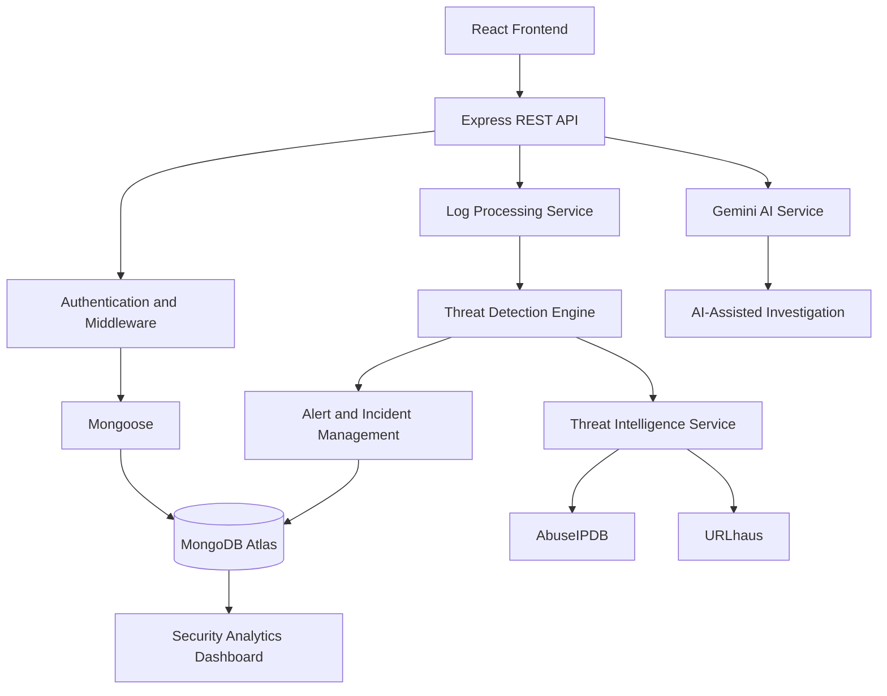

# ThreatLens 🛡️

### AI-Assisted Cyber Threat Intelligence & Incident Investigation Platform

```{=html}
<p align="center">
```
`<strong>`{=html}Turning security logs into actionable threat
intelligence.`</strong>`{=html}
```{=html}
</p>
```
```{=html}
<p align="center">
```
A full-stack cybersecurity platform for analyzing security logs,
detecting suspicious activity, enriching threat indicators, and managing
security incidents through a unified dashboard.
```{=html}
</p>
```
```{=html}
<p align="center">
```
``{=html}
```{=html}
</p>
```
```{=html}
<p align="center">
```
``{=html}
``{=html}
``{=html}
``{=html}
``{=html}
```{=html}
</p>
```

------------------------------------------------------------------------

## 📌 Overview

ThreatLens is a cybersecurity threat intelligence and incident
investigation platform designed to help security analysts identify
suspicious activity in security logs and investigate potential threats.

The platform aims to combine log ingestion, rule-based threat detection,
threat intelligence enrichment, incident management, security analytics,
and AI-assisted investigation in one interface.

Instead of manually examining large volumes of log data, users will be
able to upload supported log files, identify potentially malicious
patterns, investigate suspicious indicators, and track security
incidents through their lifecycle.

**Project vision:** Build an extensible, practical security
investigation platform that transforms raw security events into
structured findings that analysts can investigate.

## 🚧 Current Development Status

The full-stack foundation and initial backend authentication flow have
been implemented.

### Completed

-   [x] React + TypeScript + Vite frontend setup
-   [x] Tailwind CSS integration
-   [x] Node.js + Express backend setup
-   [x] Frontend-to-backend API communication
-   [x] MongoDB Atlas cloud database connection
-   [x] Mongoose database integration
-   [x] Initial User schema and model
-   [x] User registration API
-   [x] Password hashing using bcryptjs
-   [x] Duplicate-email handling in registration
-   [x] Backend health-check endpoint
-   [x] User login API
-   [x] Password verification using bcrypt
-   [x] JWT token generation
-   [x] JWT authentication middleware
-   [x] Protected current-user endpoint (`GET /api/auth/me`)
-   [x] Verified authenticated and unauthenticated requests

### In Progress / Planned

-   [ ] Duplicate registration and additional negative-case tests
-   [ ] Role-based access control
-   [ ] React frontend registration and login integration
-   [ ] Security log ingestion
-   [ ] Rule-based threat detection
-   [ ] Threat intelligence integrations
-   [ ] Gemini AI investigation
-   [ ] Security analytics dashboard
-   [ ] Automated backend test suite

------------------------------------------------------------------------

## 🎯 Problem Statement

Security logs can contain large volumes of events, making it difficult
to identify suspicious behavior quickly. Investigating potential threats
may also require analysts to switch between log files, threat
intelligence sources, and incident tracking tools.

ThreatLens aims to address these challenges through:

-   Centralized ingestion of supported security logs.
-   Automated detection of suspicious patterns using transparent rules.
-   Threat intelligence enrichment for supported indicators.
-   A unified view of alerts, incidents, and investigation status.
-   Security analytics to help users understand event patterns and alert
    trends.
-   AI-assisted explanations grounded in available investigation
    evidence.

## ✨ Key Features

Features are planned for incremental development. Their implementation
and availability will be updated as the project progresses.

### 📂 Security Log Ingestion

-   Upload supported CSV and JSON security logs.
-   Validate input data and handle malformed records.
-   Normalize supported log formats into a consistent event structure.
-   Track ingestion results and processing errors.

### 🔍 Rule-Based Threat Detection

-   Identify suspicious activity using configurable detection rules.
-   Flag events matching defined security conditions.
-   Assign severity levels to detected alerts.
-   Record the evidence and rule responsible for each alert.

### 🌐 Threat Intelligence Enrichment

-   Extract supported indicators such as IP addresses and URLs from
    security events.
-   Integrate with external threat intelligence services such as
    AbuseIPDB and URLhaus.
-   Enrich indicators with available reputation and threat context.
-   Handle API errors, rate limits, and unavailable results gracefully.

### 🚨 Alert Management

-   View and filter alerts by severity, status, and time.
-   Inspect the underlying event and detection evidence.
-   Track alerts through an investigation workflow.
-   Reduce duplicate findings where appropriate.

### 🕵️ Incident Investigation

-   Group related alerts into incidents.
-   Maintain investigation notes and status.
-   Track incident severity and resolution.
-   Preserve a clear trail of investigation decisions.

### 📊 Security Analytics Dashboard

-   Display event, alert, and incident summaries.
-   Visualize alert severity distribution.
-   Explore trends in security events over time.
-   Highlight important findings for further investigation.

### 🤖 AI-Assisted Investigation

-   Use the Google Gemini API to summarize investigation evidence.
-   Explain why an alert may require attention.
-   Suggest practical next steps for analyst review.
-   Keep AI analysis grounded in supplied event and threat-intelligence
    data.

AI-generated output is intended to assist analysts, not replace human
investigation or confirm malicious activity on its own.

### 🔐 Authentication and Security

**Implemented:**

-   User schema using Mongoose.
-   User registration endpoint with required-field and password-length
    validation.
-   Password hashing using bcryptjs.
-   Duplicate-email handling in registration.
-   User login endpoint with bcrypt password verification.
-   JWT access-token generation using environment-based configuration.
-   JWT authentication middleware for protected routes.
-   Protected endpoint for retrieving the authenticated user's details.
-   Generic rejection of missing, invalid, or expired JWTs with HTTP
    `401 Unauthorized`.

**Planned:**

-   Role-based access control.
-   Improved request validation and automated security testing.
-   React frontend integration for registration and login.

------------------------------------------------------------------------

## 🖥️ Application Preview

The following image paths are placeholders. Add your own screenshots to
the `images/` directory as the corresponding features become available.

### Dashboard

```{=html}
<p align="center">
```
``{=html}
```{=html}
</p>
```
Planned view: security event summaries, alert statistics, severity
distribution, and recent activity.

### Alert Investigation

```{=html}
<p align="center">
```
``{=html}
```{=html}
</p>
```
Planned view: searchable alerts with severity, detection reasons, and
investigation status.

### Incident Management

```{=html}
<p align="center">
```
``{=html}
```{=html}
</p>
```
Planned view: incident details, related alerts, investigation notes, and
resolution tracking.

------------------------------------------------------------------------

## 🏗️ System Architecture

ThreatLens is being developed as a MERN-based full-stack application,
with a React frontend, Node.js/Express API, MongoDB persistence, and
external AI and threat intelligence integrations.

### Architecture Components

  -----------------------------------------------------------------------
  Component                           Responsibility
  ----------------------------------- -----------------------------------
  React + TypeScript                  User interface and dashboard

  Tailwind CSS                        Frontend styling and responsive
                                      layouts

  Node.js + Express                   Backend API and request handling

  Mongoose                            MongoDB object modeling

  Authentication Middleware           JWT verification and protected API
                                      access

  Log Processing Service              Validation and normalization of
                                      uploaded logs

  Detection Engine                    Evaluation of security events
                                      against detection rules

  Threat Intelligence Service         Enrichment of supported indicators

  Google Gemini API                   Evidence-grounded AI-assisted
                                      investigation

  MongoDB Atlas                       Persistent cloud database

  Analytics Layer                     Aggregation of data for dashboard
                                      visualizations
  -----------------------------------------------------------------------

The architecture represents the intended design. Components will be
implemented incrementally.

### Application Flow



## 🧰 Technology Stack

  Technology          Purpose
  ------------------- ----------------------------------------
  React               Frontend library
  TypeScript          Frontend type safety
  Vite                Frontend development and build tooling
  Tailwind CSS        Styling
  Node.js             Backend runtime
  Express.js          REST API framework
  MongoDB Atlas       Cloud database
  Mongoose            MongoDB object modeling
  bcryptjs            Password hashing and verification
  jsonwebtoken        JWT creation and verification
  Google Gemini API   Planned AI-assisted investigation
  AbuseIPDB           Planned IP reputation enrichment
  URLhaus             Planned malicious URL intelligence

------------------------------------------------------------------------

## 📁 Project Structure

``` text
ThreatLens/
├── README.md
├── frontend/
│   ├── public/
│   ├── src/
│   │   ├── assets/
│   │   ├── components/
│   │   ├── layouts/
│   │   ├── pages/
│   │   ├── services/
│   │   ├── hooks/
│   │   └── types/
│   ├── package.json
│   └── package-lock.json
└── server/
    ├── src/
    │   ├── config/
    │   │   └── db.js
    │   ├── controllers/
    │   │   └── authController.js
    │   ├── middleware/
    │   │   └── authMiddleware.js
    │   ├── models/
    │   │   └── User.js
    │   ├── routes/
    │   │   └── authRoutes.js
    │   ├── services/
    │   │   ├── detection/
    │   │   ├── intelligence/
    │   │   └── ai/
    │   ├── utils/
    │   └── server.js
    ├── tests/
    ├── .env
    ├── .env.example
    ├── package.json
    └── package-lock.json
```

**Note:** `.env` is a local configuration file and must never be
committed to GitHub. `.env.example` contains placeholder values only.
Additional modules and directories will be added as development
continues.

------------------------------------------------------------------------

## ⚙️ Getting Started

Follow these instructions to run ThreatLens locally.

### Prerequisites

Install the following tools:

-   [Node.js](https://nodejs.org/) and npm
-   [Git](https://git-scm.com/)
-   [Visual Studio Code](https://code.visualstudio.com/)
-   A [MongoDB Atlas](https://www.mongodb.com/cloud/atlas) account

### 1. Clone the Repository

``` bash
git clone <YOUR_REPOSITORY_URL>
cd ThreatLens
```

Replace `<YOUR_REPOSITORY_URL>` with your actual GitHub repository URL.

### 2. Set Up the Frontend

Open a terminal in the project root:

``` bash
cd frontend
npm install
npm run dev
```

Frontend development server:

``` text
http://localhost:5173
```

### 3. Set Up the Backend

Open a second terminal in the project root:

``` bash
cd server
npm install
```

Create a `.env` file inside the `server/` directory using `.env.example`
as a reference.

Configure the following variables:

``` env
PORT=5000
MONGODB_URI=your_mongodb_connection_string
JWT_SECRET=your_long_random_secret
JWT_EXPIRES_IN=1d
```

Generate a strong random value for `JWT_SECRET` using Node.js:

``` bash
node -e "console.log(require('crypto').randomBytes(64).toString('hex'))"
```

Use the generated value only in your local `.env` file. Keep a
placeholder in `.env.example`.

Additional API credentials will be added when their respective
integrations are implemented.

**Important:** Never upload your actual `.env` file, JWT secret,
database credentials, or API keys to GitHub.

### 4. Start the Backend

From the `server/` directory:

``` bash
npm run dev
```

Backend server:

``` text
http://localhost:5000
```

### 5. Verify the Backend

Open:

``` text
http://localhost:5000/api/health
```

A successful response from the currently implemented health-check
endpoint looks like:

``` json
{
  "success": true,
  "message": "ThreatLens API is running!",
  "timestamp": "..."
}
```

### 6. Verify the Database Connection

The backend connects to MongoDB Atlas before starting the Express
server.

A successful connection displays messages similar to:

``` text
MongoDB connected: <cluster-host>
ThreatLens server running on port 5000
```

If the database connection fails, verify your MongoDB URI, database user
credentials, and Atlas network access configuration.

------------------------------------------------------------------------

## 🔐 Implemented API Endpoints

The following endpoints are currently implemented.

  ----------------------------------------------------------------------------
  Method            Endpoint               Description       Authentication
  ----------------- ---------------------- ----------------- -----------------
  GET               `/api/health`          Check backend     Public
                                           health            

  POST              `/api/auth/register`   Register a new    Public
                                           user              

  POST              `/api/auth/login`      Authenticate a    Public
                                           user and return a 
                                           JWT               

  GET               `/api/auth/me`         Retrieve the      Bearer JWT
                                           authenticated     required
                                           user's details    
  ----------------------------------------------------------------------------

### User Registration

Endpoint:

``` text
POST /api/auth/register
```

Example request:

``` json
{
  "name": "Test User",
  "email": "testuser@example.com",
  "password": "your_password"
}
```

The registration controller currently:

-   Validates required fields.
-   Checks minimum password length.
-   Checks for an existing email address.
-   Hashes the password using bcryptjs.
-   Creates a user record in MongoDB.
-   Returns the created user's basic information without exposing the
    password.

### User Login

Endpoint:

``` text
POST /api/auth/login
```

Example request:

``` json
{
  "email": "testuser@example.com",
  "password": "your_password"
}
```

On successful authentication, the API returns a JWT and basic user
information. The password hash is not included in the response.

### Get Current User

Endpoint:

``` text
GET /api/auth/me
```

This endpoint is protected by JWT authentication. Send the token in the
request header:

``` text
Authorization: Bearer <your_jwt_token>
```

A missing, invalid, or expired token is rejected with HTTP
`401 Unauthorized`.

------------------------------------------------------------------------

## 🗺️ Development Roadmap

### Phase 1 --- Initial Application Setup

-   [x] Initialize React + TypeScript frontend.
-   [x] Configure Tailwind CSS.
-   [x] Initialize Node.js + Express backend.
-   [x] Add initial backend security middleware.
-   [x] Create an API health-check endpoint.
-   [x] Establish frontend-to-backend communication.

### Phase 2 --- Database and Backend Foundation

-   [x] Configure MongoDB Atlas.
-   [x] Establish Mongoose database connection.
-   [x] Define initial User model.
-   [x] Create authentication routes and controllers.
-   [x] Implement user registration API.
-   [x] Implement password hashing using bcryptjs.
-   [x] Verify user persistence in MongoDB Atlas.
-   [ ] Add additional security event and incident models.
-   [ ] Expand request validation and automated tests.

### Phase 3 --- Authentication

-   [x] Implement user login.
-   [x] Add JWT token generation.
-   [x] Implement JWT authentication middleware.
-   [x] Protect the current-user endpoint.
-   [x] Verify authenticated and unauthenticated requests.
-   [ ] Test duplicate registration and additional negative cases.
-   [ ] Add role-based access control.
-   [ ] Integrate authentication with the React frontend.

### Phase 4 --- Log Management

-   [ ] Implement CSV/JSON log upload.
-   [ ] Validate and normalize log records.
-   [ ] Store and retrieve security events.
-   [ ] Handle malformed and unsupported input files.

### Phase 5 --- Threat Detection

-   [ ] Develop configurable rule-based detections.
-   [ ] Assign alert severity and risk scores.
-   [ ] Store detection evidence.
-   [ ] Test detection rules against sample logs.

### Phase 6 --- Threat Intelligence

-   [ ] Integrate AbuseIPDB.
-   [ ] Integrate URLhaus.
-   [ ] Handle rate limits and external API failures.
-   [ ] Display enrichment results during investigations.

### Phase 7 --- Dashboard and Incident Management

-   [ ] Build the security analytics dashboard.
-   [ ] Implement alert search and filtering.
-   [ ] Create incident investigation workflows.
-   [ ] Connect frontend pages to backend APIs.

### Phase 8 --- AI-Assisted Investigation

-   [ ] Integrate the Gemini API through the backend.
-   [ ] Generate evidence-grounded alert summaries.
-   [ ] Provide investigation suggestions with human review.

### Phase 9 --- Testing and Deployment

-   [ ] Test major user workflows.
-   [ ] Review security controls and input validation.
-   [ ] Document deployment and configuration.
-   [ ] Deploy the application and publish a live demo if feasible.

------------------------------------------------------------------------

## 🧪 Testing

Automated testing will cover the core application logic as the project
develops, including:

-   Log parsing and validation.
-   Rule-based detection behavior.
-   Alert creation and severity assignment.
-   API request validation and error responses.
-   Authentication and authorization.
-   Database operations and incident workflows.

Authentication endpoints and the protected current-user endpoint have
been manually verified during development. Automated test commands and
coverage information will be added once the test suite is established.

## 🔒 Security Considerations

ThreatLens is intended as a defensive cybersecurity and investigation
project.

-   Use synthetic, anonymized, or otherwise authorized security logs for
    development and demonstrations.
-   Validate uploaded files and impose appropriate size and format
    limits.
-   Keep credentials out of source control.
-   Store passwords using secure password hashing.
-   Keep JWT secrets private and use environment-based configuration.
-   Treat external threat intelligence results as contextual evidence,
    not definitive proof of malicious activity.
-   Do not expose sensitive logs, investigation notes, or API
    credentials in public deployments.
-   Avoid presenting rule-based alerts as confirmed attacks without
    further investigation.
-   Treat AI-generated analysis as decision support that requires human
    review.

------------------------------------------------------------------------

## 🚀 Future Enhancements

Potential improvements include:

-   Additional log source adapters.
-   Correlation of related security events.
-   Configurable detection rules.
-   Improved indicator caching and enrichment.
-   Exportable incident investigation reports.
-   Role-based access control and audit logging.
-   Evidence-grounded AI-generated incident summaries, with human
    review.
-   Containerized deployment and expanded automated testing.

These enhancements are exploratory and will be prioritized based on
project progress.

## 🤝 Contributing

This project is being developed incrementally as a learning and
portfolio project.

Suggestions, bug reports, and constructive feedback are welcome. Please
open an issue describing the proposed improvement or the problem
encountered.

## 📄 License

This project is intended to use the MIT License. A `LICENSE` file must
be added to the repository before the project is represented as formally
licensed.

## 👨‍💻 Author

**V Rohith**

-   GitHub: [RockyRohith12](https://github.com/RockyRohith12)
-   LinkedIn: [V Rohith](https://www.linkedin.com/in/v-rohith-90518535b)

------------------------------------------------------------------------

```{=html}
<p align="center">
```
`<strong>`{=html}ThreatLens --- Observe. Investigate.
Understand.`</strong>`{=html}
```{=html}
</p>
```
```{=html}
<p align="center">
```
Built to make security investigation more structured, transparent, and
accessible.
```{=html}
</p>
```
