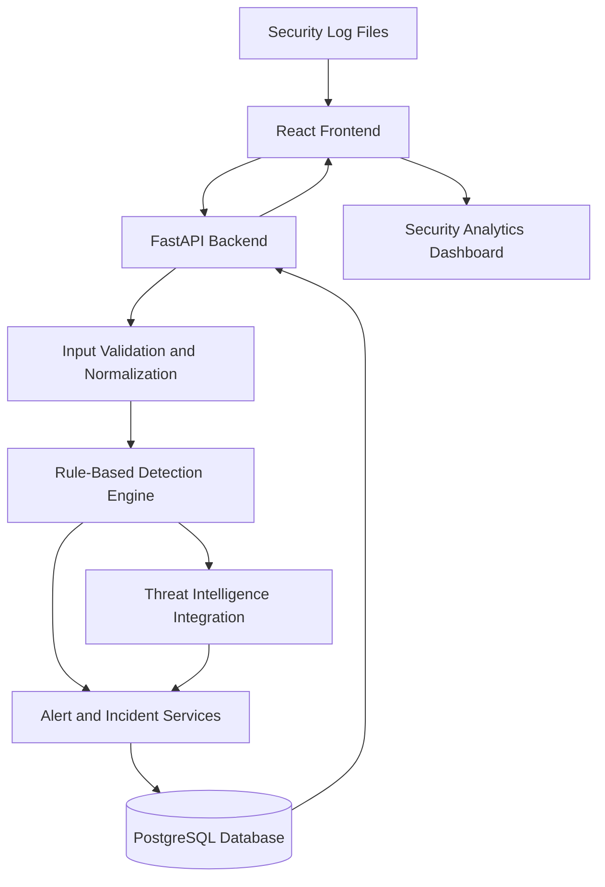

# ThreatLens 🛡️
### Cyber Threat Intelligence & Incident Investigation Platform

<p align="center">
  <strong>Turning security logs into actionable threat intelligence.</strong>
</p>

<p align="center">
  A full-stack cybersecurity platform for analyzing security logs, detecting suspicious activity, enriching threat indicators, and managing security incidents through a unified dashboard.
</p>

<p align="center">
  
</p>

<p align="center">
  
  
  
  
  
</p>

---

## 📌 Overview

**ThreatLens** is a cybersecurity threat intelligence and incident investigation platform designed to help security analysts identify suspicious activity in security logs and investigate potential threats.

The platform aims to combine log ingestion, rule-based threat detection, threat intelligence enrichment, incident management, and security analytics in one interface.

Instead of manually examining large volumes of log data, users will be able to upload supported log files, identify potentially malicious patterns, investigate suspicious indicators, and track security incidents through their lifecycle.

> **Project vision:** Build an extensible, practical security investigation platform that transforms raw security events into structured findings that analysts can investigate.

## 🎯 Problem Statement

Security logs can contain large volumes of events, making it difficult to identify suspicious behavior quickly. Investigating potential threats may also require analysts to switch between log files, threat intelligence sources, and incident tracking tools.

ThreatLens aims to address these challenges by providing:

- Centralized ingestion of supported security logs.
- Automated detection of suspicious patterns using transparent rules.
- Threat intelligence enrichment for supported indicators.
- A unified view of alerts, incidents, and investigation status.
- Security analytics to help users understand event patterns and alert trends.

## ✨ Key Features

> Features are planned for development. Their implementation and availability will be updated as the project progresses.

### 📂 Security Log Ingestion
- Upload supported CSV and JSON security logs.
- Validate input data and handle malformed records.
- Normalize supported log formats into a consistent event structure.
- Track ingestion results and processing errors.

### 🔍 Rule-Based Threat Detection
- Identify suspicious activity using configurable detection rules.
- Flag events matching defined security conditions.
- Assign severity levels to detected alerts.
- Record the evidence and rule responsible for each alert.

### 🌐 Threat Intelligence Enrichment
- Extract supported indicators such as IP addresses from security events.
- Integrate with an external threat intelligence API.
- Enrich indicators with available reputation and threat context.
- Handle API errors, rate limits, and unavailable results gracefully.

### 🚨 Alert Management
- View and filter alerts by severity, status, and time.
- Inspect the underlying event and detection evidence.
- Track alerts through an investigation workflow.
- Reduce duplicate findings where appropriate.

### 🕵️ Incident Investigation
- Group related alerts into incidents.
- Maintain investigation notes and status.
- Track incident severity and resolution.
- Preserve a clear trail of investigation decisions.

### 📊 Security Analytics Dashboard
- Display event, alert, and incident summaries.
- Visualize alert severity distribution.
- Explore trends in security events over time.
- Highlight important findings for further investigation.

### 🔐 Security and Reliability
- Validate uploaded data.
- Keep API keys and secrets outside source control.
- Apply appropriate input validation and error handling.
- Test core detection logic and API behavior.

## 🖥️ Application Preview

The following image paths are placeholders. Add your own screenshots to the `images/` directory as the corresponding features become available.

### Dashboard

<p align="center">
  
</p>

*Planned view: security event summaries, alert statistics, severity distribution, and recent activity.*

### Alert Investigation

<p align="center">
  
</p>

*Planned view: searchable alerts with severity, detection reasons, and investigation status.*

### Incident Management

<p align="center">
  
</p>

*Planned view: incident details, related alerts, investigation notes, and resolution tracking.*

## 🏗️ System Architecture

ThreatLens is planned as a frontend-backend application with a relational database and an external threat intelligence integration.



### Architecture Components

| Component | Responsibility |
|---|---|
| React + TypeScript | User interface and dashboard |
| FastAPI | Backend API and request handling |
| Log Processing Service | Validation and normalization of uploaded logs |
| Detection Engine | Evaluation of security events against detection rules |
| Threat Intelligence Service | Enrichment of supported indicators |
| PostgreSQL | Persistent storage for events, alerts, and incidents |
| Analytics Layer | Aggregation of data for dashboard visualizations |

*The architecture represents the intended design. Components will be implemented incrementally.*

## 🧰 Technology Stack

| Technology | Purpose |
|---|---|
| React | Frontend user interface |
| TypeScript | Type-safe frontend development |
| Vite | Frontend development and build tooling |
| Python | Backend development |
| FastAPI | REST API framework |
| PostgreSQL | Relational database |
| SQLAlchemy | Planned database ORM |
| Alembic | Planned database migrations |
| Pytest | Backend testing |
| Git & GitHub | Version control and project collaboration |

Additional libraries and threat intelligence providers will be documented when selected and integrated.

## 📁 Planned Project Structure

```text
ThreatLens/
├── README.md
├── .gitignore
├── images/
│   ├── threatlens-banner.png
│   ├── dashboard-preview.png
│   ├── alerts-preview.png
│   └── incidents-preview.png
├── frontend/
│   ├── public/
│   └── src/
│       ├── assets/
│       ├── components/
│       ├── layouts/
│       ├── pages/
│       ├── services/
│       ├── hooks/
│       └── types/
├── backend/
│   ├── app/
│   │   ├── api/
│   │   │   └── routes/
│   │   ├── core/
│   │   ├── db/
│   │   ├── models/
│   │   ├── schemas/
│   │   └── services/
│   ├── tests/
│   ├── alembic/
│   └── requirements.txt
└── docs/
    └── architecture.md
```

*This is the target structure, not a claim that all files and directories already exist.*

## ⚙️ Getting Started

ThreatLens is under active development. The instructions below describe the intended local development setup and will be expanded as the application becomes runnable.

### Prerequisites

Install the following tools:

- [Git](https://git-scm.com/)
- [Python](https://www.python.org/downloads/) — Python 3.10 or a compatible supported version for the initial backend setup
- [Node.js](https://nodejs.org/) — an appropriate LTS release
- [Visual Studio Code](https://code.visualstudio.com/)
- PostgreSQL — required when database integration is introduced

### 1. Clone the Repository

```bash
git clone <YOUR_REPOSITORY_URL>
cd ThreatLens
```

Replace `<YOUR_REPOSITORY_URL>` with your actual GitHub repository URL.

### 2. Set Up the Frontend

From the project root:

```bash
npm create vite@latest frontend -- --template react-ts
cd frontend
npm install
npm run dev
```

If the `frontend` directory already exists and contains project files, do not run the scaffolding command again. Follow the setup instructions for the existing frontend instead.

### 3. Set Up the Backend

Open a terminal in the `backend` directory.

For Windows with Python 3.10 installed:

```powershell
py -3.10 -m venv .venv
.\.venv\Scripts\Activate.ps1
python -m pip install --upgrade pip
python -m pip install "fastapi[standard]"
```

Once the backend dependencies are established, save the installed dependencies:

```powershell
python -m pip freeze > requirements.txt
```

The API entry point and additional configuration will be documented as they are implemented.

### 4. Database Configuration

PostgreSQL integration is planned. Database installation, connection configuration, schema migrations, and seed data instructions will be added when the database layer is implemented.

### 5. Environment Variables

External API credentials and database secrets should be stored in environment variables or an untracked `.env` file.

Never commit real API keys, passwords, or other secrets to GitHub.

## 🗺️ Development Roadmap

- [ ] **Phase 1 — Foundation**
  - [ ] Establish the repository structure.
  - [ ] Configure the React and TypeScript frontend.
  - [ ] Initialize the FastAPI backend.
  - [ ] Add project documentation and Git configuration.

- [ ] **Phase 2 — Backend Fundamentals**
  - [ ] Define security event schemas.
  - [ ] Implement log validation and normalization.
  - [ ] Create initial API endpoints.
  - [ ] Add automated tests.

- [ ] **Phase 3 — Database Integration**
  - [ ] Configure PostgreSQL.
  - [ ] Create event, alert, and incident models.
  - [ ] Add database migrations.
  - [ ] Implement persistent storage.

- [ ] **Phase 4 — Detection Engine**
  - [ ] Develop configurable rule-based detections.
  - [ ] Assign alert severity.
  - [ ] Store detection evidence.
  - [ ] Test detection rules against sample logs.

- [ ] **Phase 5 — Threat Intelligence**
  - [ ] Integrate a selected threat intelligence provider.
  - [ ] Enrich supported indicators.
  - [ ] Handle rate limits and external API failures.
  - [ ] Display enrichment results during investigations.

- [ ] **Phase 6 — Frontend and Incident Management**
  - [ ] Build the security analytics dashboard.
  - [ ] Implement alert search and filtering.
  - [ ] Create incident investigation workflows.
  - [ ] Connect the frontend to the backend APIs.

- [ ] **Phase 7 — Testing and Deployment**
  - [ ] Test the major user workflows.
  - [ ] Review security controls and input validation.
  - [ ] Document deployment and configuration.
  - [ ] Deploy the application and publish a live demo if feasible.

## 🧪 Testing

Automated testing will cover the core application logic as the project develops, including:

- Log parsing and validation.
- Rule-based detection behavior.
- Alert creation and severity assignment.
- API request validation and error responses.
- Database operations and incident workflows.

Test commands and coverage information will be added once the test suite is established.

## 🔒 Security Considerations

ThreatLens is intended as a defensive cybersecurity and investigation project.

- Use synthetic, anonymized, or otherwise authorized security logs for development and demonstrations.
- Validate uploaded files and impose appropriate size and format limits.
- Keep credentials out of source control.
- Treat external threat intelligence results as contextual evidence, not definitive proof of malicious activity.
- Do not expose sensitive logs, investigation notes, or API credentials in public deployments.
- Avoid presenting rule-based alerts as confirmed attacks without further investigation.

## 🚀 Future Enhancements

Potential improvements include:

- Additional log source adapters.
- Correlation of related security events.
- Configurable detection rules.
- Improved indicator caching and enrichment.
- Exportable incident investigation reports.
- Role-based access control and audit logging.
- Evidence-grounded AI-generated incident summaries, with human review.
- Containerized deployment and expanded automated testing.

These enhancements are exploratory and will be prioritized based on project progress.

## 🤝 Contributing

This project is being developed incrementally as a learning and portfolio project.

Suggestions, bug reports, and constructive feedback are welcome. Please open an issue describing the proposed improvement or the problem encountered.

## 📄 License

This project is intended to use the MIT License. A `LICENSE` file must be added to the repository before the project is represented as formally licensed.

## 👨‍💻 Author

**V Rohith**

- GitHub: [My GitHub Profile](https://github.com/RockyRohith12)
- LinkedIn: [My LinkedIn Profile](www.linkedin.com/in/v-rohith-90518535b)


---

<p align="center">
  <strong>ThreatLens — Observe. Investigate. Understand.</strong>
</p>

<p align="center">
  Built to make security investigation more structured, transparent, and accessible.
</p>
